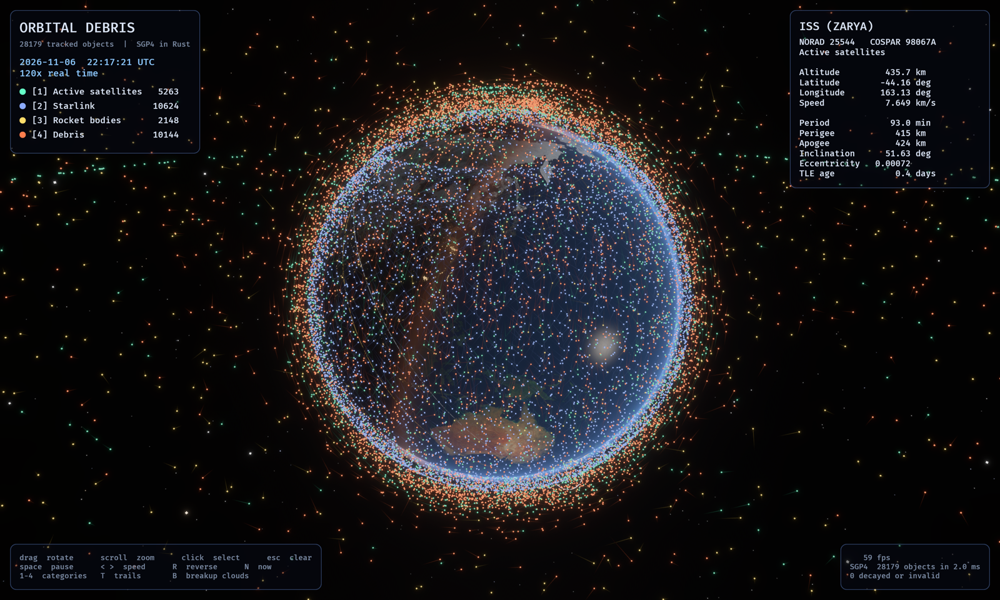
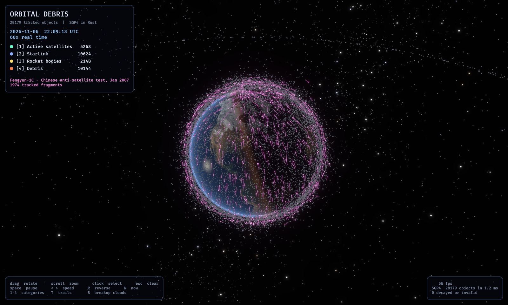

# Orbital Debris

Every object in CelesTrak's public catalog (28,179 at the last fetch) propagated
live with [sgp4-rust](../SGP4-Rust) and drawn around a sunlit Earth with Bevy.





## Run

```sh
cargo run --release
```

The catalog is a snapshot in `assets/catalog.tle`. TLEs lose accuracy over
days to weeks; refresh it with `scripts/fetch_catalog.sh` (CelesTrak blocks
repeat downloads within two hours).

## Controls

| Input | Action |
|---|---|
| Drag | Rotate the view |
| Scroll | Zoom |
| Click | Select an object: orbit, ground track, live position |
| Esc | Clear the selection |
| Space | Pause |
| `<` `>` or arrow keys | Slower / faster (1x to 3600x) |
| R | Run time backward |
| N | Jump back to now |
| 1–4 | Show or hide active satellites, Starlink, rocket bodies, debris |
| T | Motion trails |
| B | Step through the Fengyun-1C, Cosmos 2251, Iridium 33, and Cosmos 1408 breakup clouds |
| F12 | Save a screenshot |

## What it shows

- Positions come from SGP4 each frame for every object, spread across all
  cores (`Satellite::propagate_to` takes `&self`). On a 12-core Apple M4 Pro
  this takes about 2 ms per frame.
- The scene is inertial. The Earth turns by Greenwich sidereal time, and the
  Sun's direction comes from the date, so day, night, and city lights match
  the simulated moment.
- The selection panel uses the library's `Geodetic` conversion for latitude,
  longitude, and altitude, and draws one revolution of orbit and ground track.
- Objects are sorted by name: `DEB` is debris, `R/B` a rocket body, `STARLINK`
  Starlink, and everything else an active satellite.

## Sources

- `earth.jpg`: NASA Blue Marble.
- `earth_night.jpg`: NASA Black Marble 2016, downscaled to 4096×2048.
- `catalog.tle`: CelesTrak GP data (`GROUP=active`, `NAME=DEB`, `NAME=R/B`,
  and the four breakup groups).

## Scripted screenshots

`src/capture.rs` reads `DEMO_SCREENSHOT`, `DEMO_CAMERA`, `DEMO_SELECT`,
`DEMO_BREAKUP`, `DEMO_HIDE`, `DEMO_TRAILS`, and `DEMO_RATE_STEPS` to take a
screenshot without a person at the controls. For example:

```sh
DEMO_SCREENSHOT=out.png DEMO_BREAKUP=0 DEMO_SELECT=none cargo run --release
```
